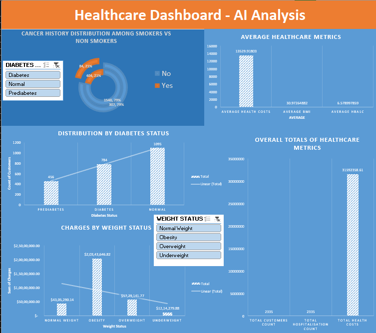

# Excel Assignments & Projects

Welcome to my Excel repository!

This repository showcases my practical assignments and projects completed as part of my Data Analytics learning journey. It includes hands-on work involving data exploration, data cleaning, data analysis and dashboard development using Microsoft Excel.

## 📂 Assignments & Projects

### Assignment 1 – Data Exploration

**File:** `Assignment 1 Data Exploration.xlsx`

**Key Areas Covered:**
- Exploring and understanding datasets
- Data summarisation
- Basic statistical analysis
- Using Excel formulas and functions
- Identifying patterns and insights from data

### Assignment 2 – Data Cleaning

**Files:**
- `Assignment 2 Data Cleaning.xlsx`
- `Assignment 2 Data Cleaning.pdf`

**Key Areas Covered:**
- Data cleaning and preparation
- Identifying and handling missing or inconsistent values
- Organising structured datasets
- Preparing data for further analysis

### Excel Capstone Project – AI-Powered Healthcare Data Insights and Dashboarding
### Dashboard Preview

**File:** `Excel Capstone Project AI powered Healthcare Data Insights and Dashboarding.xlsx`

**Project Overview:**

A capstone project focused on exploring healthcare data and presenting meaningful insights through Microsoft Excel. The project combines data analysis with dashboard development to support clearer interpretation of the available information.

## 🛠️ Tools & Technologies

- Microsoft Excel
- Excel Formulas and Functions
- Data Cleaning and Preparation
- Data Analysis
- Charts and Visualisation
- Dashboard Development

## 📊 Skills Demonstrated

- Data Exploration
- Data Cleaning
- Data Transformation
- Data Analysis
- Data Interpretation
- Data Visualisation
- Dashboard Development

## 🎯 Objective

To strengthen my Excel skills through practical assignments and projects, develop a better understanding of data analysis and transform raw data into meaningful insights.

## 📌 About This Repository

This repository reflects my continuous learning and practical progress in Data Analytics. More assignments and projects will be added as I continue developing my skills.
